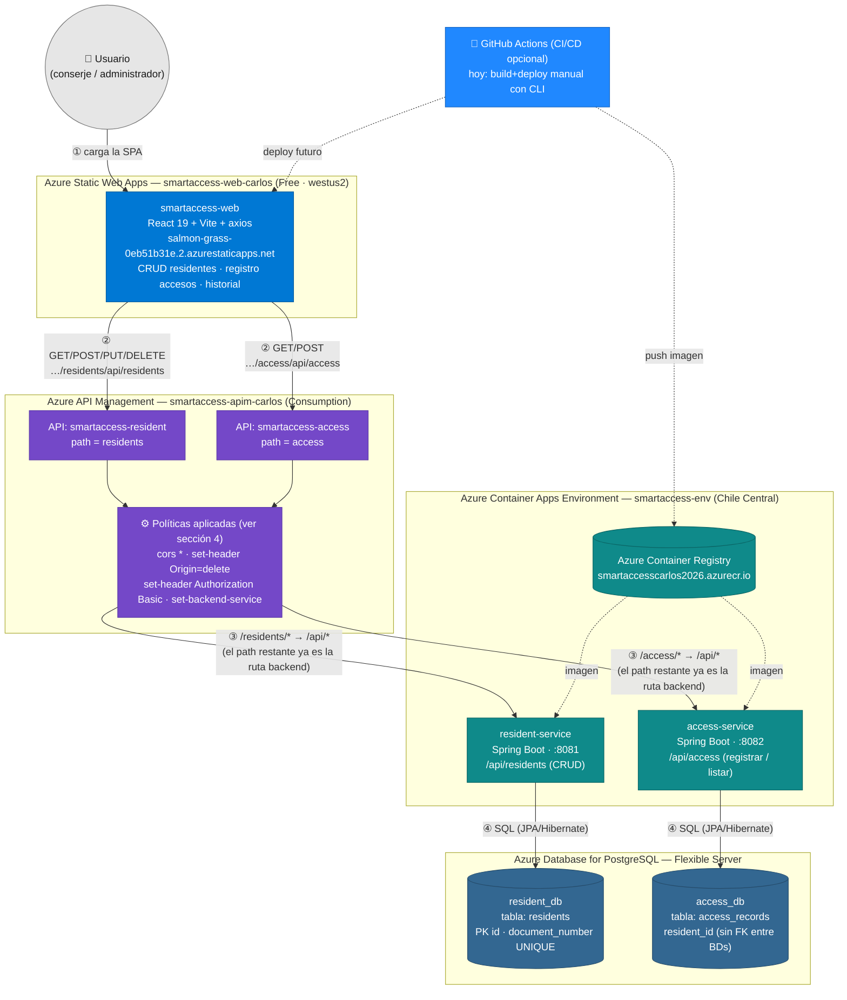

# SmartAccess — Diagrama de Arquitectura

Arquitectura del sistema **TAS SmartAccess**: gestión de residentes y accesos residenciales
desplegada en Azure, expuesta mediante API Management.

> **Estado de despliegue (2026-10-19):** ✅ APIM + Container Apps + bases de datos + frontend
> desplegado en Azure Static Web Apps. Frontend desplegado con CLI local (**sin GitHub**).

---

## 1. Diagrama general (Mermaid)

> Se renderiza automáticamente en GitHub y en VS Code (extensión Markdown Preview Mermaid Support).



### Puntos clave del diagrama

1. **El frontend solo habla con el APIM** — nunca llama directamente a los Container Apps.
2. **No existe comunicación entre `resident-service` y `access-service`**. El cruce
   residente↔acceso lo hace el frontend en memoria (`getResidentName`, `App.jsx:359`).
   No dibujes flecha entre los dos servicios.
3. **Las dos BD son independientes** (patrón Database-per-Service). `access_records.resident_id`
   es una referencia lógica, sin foreign key entre bases de datos.
4. **No hace falta `rewrite-uri`**: el path del API en APIM (`residents` / `access`) hace que
   el resto de la URL (`/api/residents`) llegue a los controladores tal cual (ver sección 3).
5. **CORS en dos capas**: el APIM valida el origen y luego **elimina el header `Origin`**
   antes de reenviar, porque los servicios Java solo aceptan `http://localhost:5173`
   (ver sección 4).
6. **Los flujos de red (① a ④)** se explican en la sección 5.

---

## 2. Guía para dibujarlo en Canva

### 2.1 Estructura de página

- Orientación: **vertical (retrato)** o cuadrada.
- **5 franjas horizontales** de arriba hacia abajo, cada una con un rectángulo redondeado
  con título de franja (subgraph) y sus cajas internas.

### 2.2 Cajas — texto literal y colores

| Franja (contenedor) | Color franja | Caja | Texto exacto de la caja | Color caja |
|---|---|---|---|---|
| **Cliente** | Gris claro `#E6E6E6` (borde `#747474`) | Usuario | `👤 Usuario (navegador)` | Gris `#E6E6E6`, texto `#1A1A1A` |
| **Azure Static Web Apps — smartaccess-web-carlos** | Azul `#0078D4` (borde `#005A9E`) | smartaccess-web | `smartaccess-web`<br/>`React 19 + Vite + axios`<br/>`salmon-grass-0eb51b31e.2.azurestaticapps.net` | Azul `#0078D4`, texto blanco |
| **Azure API Management — smartaccess-apim-carlos** | Morado `#7448C8` (borde `#5A37A8`) | API resident | `API: smartaccess-resident`<br/>`path = residents` | Morado `#7448C8`, texto blanco |
| *ídem* | *ídem* | API access | `API: smartaccess-access`<br/>`path = access` | Morado `#7448C8`, texto blanco |
| *ídem* | *ídem* | Políticas | `⚙️ cors * · Origin=delete · Authorization Basic · set-backend-service` | Morado claro `#9B7AE0`, texto blanco |
| **Azure Container Apps Environment — smartaccess-env** | Teal `#0F8A8A` (borde `#0A6565`) | resident-service | `resident-service`<br/>`Spring Boot · :8081`<br/>`/api/residents (CRUD)` | Teal `#0F8A8A`, texto blanco |
| *ídem* | *ídem* | access-service | `access-service`<br/>`Spring Boot · :8082`<br/>`/api/access (registrar / listar)` | Teal `#0F8A8A`, texto blanco |
| *ídem* | *ídem* | ACR | `Azure Container Registry`<br/>`smartaccesscarlos2026.azurecr.io` | Gris-azul `#50A4E2`, texto blanco |
| **Azure Database for PostgreSQL — Flexible Server** | Azul `#336791` (borde `#254B6A`) | resident_db | `resident_db`<br/>`tabla: residents` | Azul `#336791`, texto blanco |
| *ídem* | *ídem* | access_db | `access_db`<br/>`tabla: access_records` | Azul `#336791`, texto blanco |
| **CI/CD (opcional)** | Azul GitHub `#2088FF` | GitHub Actions | `🔁 GitHub Actions`<br/>`deploy futuro (hoy manual con CLI)` | Azul `#2088FF`, texto blanco |

### 2.3 Flechas — etiquetas exactas

| # | Origen → Destino | Estilo | Etiqueta |
|---|---|---|---|
| ① | Usuario → smartaccess-web | sólida, gris oscuro `#4A4A4A` | `carga la SPA` |
| ② | smartaccess-web → API resident | sólida | `GET/PUT/DELETE/POST …/residents/api/residents` |
| ② | smartaccess-web → API access | sólida | `GET/POST …/access/api/access` |
| ③ | Políticas → resident-service | sólida | `resto de la ruta = /api/residents (sin rewrite)` |
| ③ | Políticas → access-service | sólida | `resto de la ruta = /api/access (sin rewrite)` |
| ④ | resident-service → resident_db | sólida | `SQL (JPA/Hibernate)` |
| ④ | access-service → access_db | sólida | `SQL (JPA/Hibernate)` |
| – | ACR → los 2 servicios | **punteada** | `imagen` |
| – | GitHub Actions → ACR/SPA | **punteada** | `deploy` |

> **Tip:** colorea las etiquetas ①–④ con el mismo color para que el ojo siga el recorrido.

### 2.4 Frontend desplegado

Ya está desplegado con **Ruta A (CLI local, sin GitHub)**:

| Campo | Valor |
|---|---|
| Recurso | `smartaccess-web-carlos` (SKU **Free**, región `westus2`) |
| URL pública | **https://salmon-grass-0eb51b31e.2.azurestaticapps.net** |
| RG | `rg-smartaccess-demo` |
| Comando de redeploy (tras cambios en el código) | ver sección 6.3 |

> La región `westus2` fue la única de las 5 que permite Static Web Apps en esta
> suscripción Student (política bloquea `centralus`, `eastus2`, `westeurope`, `eastasia`).

---

## 3. Contrato de rutas (frontend ↔ APIM ↔ backend)

La URL del frontend (`residentApi.js:4` y `accessApi.js:4`) es
`https://smartaccess-apim-carlos.azure-api.net/{residents|access}/api`:

| Frontend (axios) | URL pública APIM | Ruta que llega al backend |
|---|---|---|
| `GET /residents` | `GET /residents/api/residents` | `GET :8081/api/residents` |
| `POST /residents` | `POST /residents/api/residents` | `POST :8081/api/residents` |
| `GET /residents/{id}` | `GET /residents/api/residents/{id}` | `GET :8081/api/residents/{id}` |
| `PUT /residents/{id}` | `PUT /residents/api/residents/{id}` | `PUT :8081/api/residents/{id}` |
| `DELETE /residents/{id}` | `DELETE /residents/api/residents/{id}` | `DELETE :8081/api/residents/{id}` |
| `GET /access` | `GET /access/api/access` | `GET :8082/api/access` |
| `GET /access/{id}` | `GET /access/api/access/{id}` | `GET :8082/api/access/{id}` |
| `GET /access/resident/{residentId}` | `GET /access/api/access/resident/{residentId}` | `GET :8082/api/access/resident/{residentId}` |
| `POST /access` | `POST /access/api/access` | `POST :8082/api/access` |

**Configuración real en APIM (verificada):**

| API | Path del API | Backend (*set-backend-service*) | URL del backend |
|---|---|---|---|
| `smartaccess-resident` | `residents` | `ContainerApp_smartaccess-resident` | `https://smartaccess-resident.braveforest-ab3650c6.chilecentral.azurecontainerapps.io` |
| `smartaccess-access` | `access` | `ContainerApp_smartaccess-access` | `https://smartaccess-access.braveforest-ab3650c6.chilecentral.azurecontainerapps.io` |

**Cómo funciona (sin rewrite):** APIM hace *match* con el path del API (`residents`) y
reenvía el **resto** de la URL al backend. `…/residents` + resto `/api/residents`
= `/api/residents`, que es exactamente el `@RequestMapping("/api/residents")` de los
controladores. La política `<set-backend-service>` elige el Container App correcto.

**Suscripción:** las APIs tienen `subscriptionRequired = false` (hoy son abiertas —
ver recomendación de seguridad en la sección 4).

---

## 4. Políticas APIM

### 4.1 Aplicadas hoy (verificadas por REST, 2026-10-19)

Política efectiva a nivel de cada API (`smartaccess-resident` y `smartaccess-access`),
más la **política global** del servicio (que solo contiene un `<cors>` con `*`):

```xml
<policies>
	<inbound>
		<base />                                    <!-- incluye la política global (cors) -->
		<set-header name="Authorization" exists-action="override">
			<value>Basic YWRtaW46YWRtaW4=</value>  <!-- inyecta Basic admin:admin al backend -->
		</set-header>
		<cors allow-credentials="false">
			<allowed-origins><origin>*</origin></allowed-origins>
			<allowed-methods>
				<method>GET</method><method>POST</method>
				<method>PUT</method><method>DELETE</method><method>OPTIONS</method>
			</allowed-methods>
			<allowed-headers><header>*</header></allowed-headers>
		</cors>
		<set-header name="Origin" exists-action="delete" />
		<set-backend-service id="apim-generated-policy" backend-id="ContainerApp_smartaccess-resident" />
	</inbound>
	<backend><base /></backend>
	<outbound><base /></outbound>
	<on-error><base /></on-error>
</policies>
```

**Por qué `Origin = delete`:** los `CorsConfig` de Java solo permiten
`http://localhost:5173`. Si el APIM reenvía el `Origin` del navegador
(`https://salmon-grass-…azurestaticapps.net`), Spring devuelve
`403 Invalid CORS request`. Como el APIM ya validó el CORS antes
(y responde el `OPTIONS` preflight él mismo), borra `Origin` para que el
backend no vuelva a validar. **Verificado:** GET → `200` con JSON,
preflight OPTIONS → `200` con `Access-Control-Allow-Origin: *`.

> En `accessApi.js:5` y `residentApi.js:5` se indica que el APIM debe encargarse de la
> seguridad: esa responsabilidad **ya está implementada en la capa de políticas**
> (CORS + Authorization Basic al backend), no en headers del cliente.

### 4.2 Recomendadas (pendientes)

| Política | Propósito | Dónde |
|---|---|---|
| `rate-limit` (p. ej. 100 req/min por clave) | Proteger los servicios de ráfagas/abuso | Todas las operaciones |
| `validate-jwt` o habilitar **subscription key** | Las APIs hoy están abiertas (`subscriptionRequired=false`) — cualquiera puede llamarlas | Todas las operaciones |
| `validate-content` en `POST` | Rechazar cuerpos grandes o sin `Content-Type: application/json` | Operaciones `POST` |
| `log-to-eventhub` / **Application Insights** | Trazabilidad y métricas de latencia/errores | Global |
| `retry` en `GET` | Reintentos ante 5xx/timeout (**solo GET**, nunca en `POST/PUT/DELETE`) | Operaciones `GET` |

---

## 5. Leyenda de flujos

| Flujo | Qué ocurre |
|---|---|
| **①** | El navegador descarga la SPA (HTML/JS/CSS) desde `salmon-grass-0eb51b31e.2.azurestaticapps.net`. |
| **②** | La SPA llama a la URL pública del APIM (sin clave de suscripción hoy). |
| **③** | El APIM valida CORS con el origen, inyecta `Authorization: Basic admin:admin`, **borra `Origin`** y reenvía al Container App elegido por `set-backend-service`. |
| **④** | El servicio Java persiste/consulta con JPA (Hibernate) contra su base de datos en el Flexible Server. |

---

## 6. Recursos y comandos de referencia

### 6.1 Recursos reales en Azure

| Recurso | Valor |
|---|---|
| Suscripción | `Azure for Students` (`5937e7ce-a7a7-4e8a-a576-bb989683ac60`) |
| Resource group | `rg-smartaccess-demo` (Chile Central) |
| APIM | `smartaccess-apim-carlos` — Consumption — `https://smartaccess-apim-carlos.azure-api.net` |
| ACA Environment | `smartaccess-env` (Chile Central) |
| Container Apps | `smartaccess-resident` (:8081), `smartaccess-access` (:8082) |
| ACR | `smartaccesscarlos2026.azurecr.io` |
| Frontend (SWA) | `smartaccess-web-carlos` → `https://salmon-grass-0eb51b31e.2.azurestaticapps.net` |
| PostgreSQL | Flexible Server con `resident_db` y `access_db` |

### 6.2 Desplegar cambios en los microservicios

```bash
# build + push de la imagen (ejemplo para resident-service)
az acr build -r smartaccesscarlos2026 -t resident-service:latest ./services/resident-service

# actualizar la Container App
az containerapp update -n smartaccess-resident -g rg-smartaccess-demo \
  --image smartaccesscarlos2026.azurecr.io/resident-service:latest
```

### 6.3 Redesplegar el frontend (tras cambios en el código)

```powershell
# 1. build
cd frontend/smartaccess-web; npm run build

# 2. token de despliegue (se guardó una vez; si se pierde, volver a generarlo)
az staticwebapp secrets list -n smartaccess-web-carlos -g rg-smartaccess-demo --query properties.apiKey -o tsv

# 3. despliegue
npx "@azure/static-web-apps-cli" deploy ./dist --deployment-token <TOKEN> --env production
```

### 6.4 Consultar las políticas del APIM

```powershell
# path correcto: "service" (singular) y api-version 2024-05-01
# https://management.azure.com/subscriptions/<sub>/resourceGroups/<rg>/providers/Microsoft.ApiManagement/service/<apim>
az rest --method put --url ".../apis/smartaccess-resident/policies/policy?api-version=2024-05-01" --body @body.json
```

### 6.5 Código del proyecto

| Parte | Ubicación |
|---|---|
| Frontend | `frontend/smartaccess-web` (React 19, Vite, axios) |
| Servicios | `services/resident-service` y `services/access-service` (Spring Boot 4.1.1, Java 21) |
| BD locales (dev) | `docker-compose.yml` — PostgreSQL 16 en puertos 5433 y 5434 |
