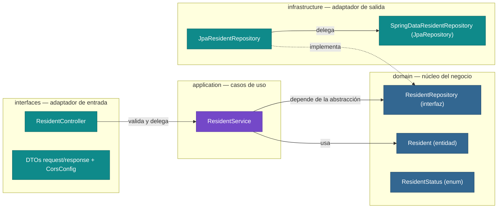
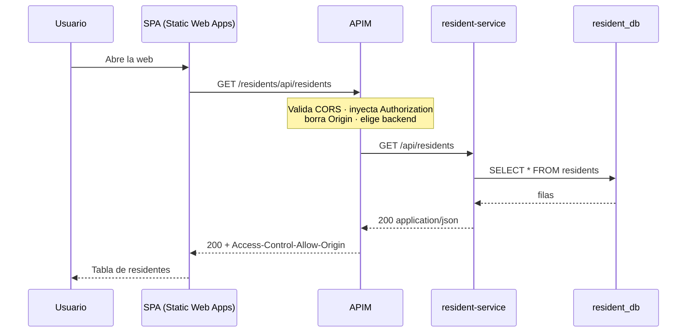

# Sustentación — SOLID y DDD en SmartAccess

Documento de apoyo para la exposición del demo **SmartAccess** (2 microservicios Spring Boot +
Azure API Management + web React). Contiene: arquitectura por capas, evidencia de cada
principio SOLID con referencias `archivo:línea`, elementos de DDD, las 3 características del
gateway, guion del demo y respuestas a preguntas probables.

> Documento complementario: [`arquitectura.md`](./arquitectura.md) (diagrama de despliegue,
> recursos Azure y comandos).

---

## 0. Cómo usar este documento

| Si el profe pide… | Ir a… |
|---|---|
| "Explícame cómo estructuraste las capas" | §2.2 y §2.3 |
| "¿Dónde está SOLID en tu código?" | §3 (tabla con evidencia) |
| "¿Qué es DDD y cómo lo aplicaste?" | §2.1 y §2.4 |
| "¿Qué características configuraste en el APIM?" | §5 |
| "Haz el demo" | §6 |
| "¿Qué mejorarías?" | §4 |

---

## 1. Resumen ejecutivo (para abrir la exposición)

> "SmartAccess es un sistema de control de accesos residenciales compuesto por **dos
> microservicios** Spring Boot con arquitectura por capas al estilo **DDD** —`interfaces`,
> `application`, `domain` e `infrastructure`— cada uno con su propio **bounded context** y su
> propia base de datos PostgreSQL (*database per service*). Ambos se exponen a través de
> **Azure API Management**, que aplica **CORS, enriquecimiento de headers y enrutamiento a los
> backends**; y un frontend React desplegado en **Azure Static Web Apps** consume las **dos APIs
> exclusivamente a través del gateway**."

---

## 2. Arquitectura de los dos microservicios

### 2.1 Contextos delimitados (Bounded Contexts)

Cada microservicio es un **contexto delimitado** con su propio modelo, lenguaje, base de datos
y ciclo de despliegue. No comparten entidades ni tablas.

| | `resident-service` | `access-service` |
|---|---|---|
| **Responsabilidad** | Administrar residentes (CRUD) | Registrar y consultar eventos de acceso |
| **Puerto local** | 8081 | 8082 |
| **Base de datos** | `resident_db` → tabla `residents` | `access_db` → tabla `access_records` |
| **API en APIM** | `smartaccess-resident` (path `residents`) | `smartaccess-access` (path `access`) |
| **Entidad principal** | `Resident` | `AccessRecord` |
| **Lenguaje ubicuo** | `name`, `documentNumber`, `apartment`, `email`, `ACTIVE/INACTIVE` | `residentId`, `accessType`, `FACIAL/RFID/FINGERPRINT`, `AUTHORIZED/DENIED`, `accessDate` |

**Relación entre contextos:** `access-service` referencia al residente por **identificador
(`residentId`), sin foreign key entre bases de datos**. Es una referencia lógica, no física:
cada contexto es autónomo y puede evolucionar/escalar/desplegarse por separado. La unión de
datos para mostrarlos juntos la hace el **frontend** en memoria
(`App.jsx:359-368`, función `getResidentName`). No hay llamadas HTTP directas entre los dos
microservicios: el acoplamiento es mínimo y vía datos, no vía código.

Evidencia:
- Dos bases separadas: `docker-compose.yml:3-25`.
- Dos servicios independientes: `docker-compose.yml:27-53`.
- `AccessRecord.java:15-16` — solo guarda `residentId` (sin FK/JPA relation).
- Frontend resuelve el nombre del residente: `frontend/smartaccess-web/src/App.jsx:359-368`.

### 2.2 Diagrama de capas y dirección de dependencias



**Dirección de las dependencias (lo más importante):**

- `interfaces` (HTTP) → `application` → `domain`: las capas externas conocen a las internas.
- `infrastructure` → `domain`: implementa la interfaz de repositorio definida en el dominio.
- **El dominio no conoce a nadie**: `ResidentRepository` es una interfaz propia del dominio
  (`ResidentRepository.java:8-18`) y no importa nada de JPA ni de Spring Web.
- `ResidentService` inyecta la **interfaz** por constructor (`ResidentService.java:15-18`);
  en tiempo de ejecución Spring le entrega `JpaResidentRepository`
  (`JpaResidentRepository.java:11-12`).

El mismo patrón se replica en `access-service`:
`AccessRecordRepository.java:8-16` (interfaz) ↔ `JpaAccessRecordRepository.java:10-12`
(implementación) e inyección por constructor en `AccessService.java:14-20`.

### 2.3 Responsabilidad de cada capa

| Capa / paquete | Clases (ejemplo) | Responsabilidad única |
|---|---|---|
| `interfaces.rest` | `ResidentController.java:15-78` | Exponer HTTP REST, validar entrada con `@Valid`, mapear DTO ↔ dominio. **No tiene lógica de negocio ni SQL.** |
| `interfaces.rest.dto` | `CreateResidentRequest.java:6-20`, `ResidentResponse.java:6-25` | Contrato de entrada/salida y validaciones de formato (Bean Validation). Aíslan el dominio del formato HTTP (capa anticorrupción). |
| `application.service` | `ResidentService.java:12-72` | Orquestar los casos de uso (crear, listar, actualizar, eliminar) y reglas de aplicación (p. ej. documento duplicado). |
| `domain.model` | `Resident.java:5-89`, `ResidentStatus.java:3-6` | Entidad y estados del negocio, con identidad propia (`id`). |
| `domain.repository` | `ResidentRepository.java:8-18` | Contrato de persistencia **definido por el dominio** (patrón Repository de DDD). |
| `infrastructure.persistence` | `JpaResidentRepository.java:11-44`, `SpringDataResidentRepository.java:6-10` | Implementar la persistencia real con Spring Data JPA / PostgreSQL. |
| `interfaces.rest.CorsConfig` | `CorsConfig.java:8-22` | Configuración transversal de CORS aislada en su propia clase. |

### 2.4 Elementos de DDD presentes en el código

| Patrón DDD | Dónde está | Explicación |
|---|---|---|
| **Bounded Context** | `resident-service` / `access-service` | Dos modelos separados, dos BDs, dos despliegues. |
| **Lenguaje ubicuo** | `Resident`, `apartment`, `documentNumber`, `AccessRecord`, `AUTHORIZED`, `DENIED` | Los nombres del negocio se usan igual en código, BD (`document_number`), API (`accessType`) y UI. |
| **Entidad (identidad)** | `Resident.java:9-11`, `AccessRecord.java:11-13` | `@Id` autogenerado: la identidad no depende de los atributos. |
| **Aggregate Root** | `Resident` | Punto de acceso a la consistencia de sus datos (documento único: `Resident.java:16-17`). |
| **Repositorio** | `domain/repository/*` + `infrastructure/persistence/*` | Abstracción en el dominio; implementación en infraestructura. |
| **Estados como tipos del dominio** | `ResidentStatus`, `AccessType`, `AccessStatus` (enums) | Evitan "strings mágicos" y restringen los valores válidos. |
| **Capa anticorrupción (ACL)** | DTOs `*Request` / `*Response` | El modelo de dominio no se expone directamente por HTTP. |
| **Context mapping vía identificadores** | `AccessRecord.residentId` | Integración por ID, sin compartir modelo ni BD. |

### 2.5 Diagrama de secuencia (una petición real)



---

## 3. Principios SOLID aplicados

> Cada fila tiene la evidencia exacta para mostrar en el IDE durante la sustentación.

| Principio | Cómo se cumple | Evidencia | Frase para decir |
|---|---|---|---|
| **S** — *Single Responsibility* | Cada clase tiene **una sola razón de cambio**: el controller solo traduce HTTP, el service solo orquesta casos de uso, el repositorio solo persiste. `CorsConfig` aísla la configuración CORS. | `ResidentController.java:15-78` · `ResidentService.java:21-71` · `JpaResidentRepository.java:20-43` · `CorsConfig.java:8-22` | "Si cambia el formato HTTP, solo cambia el controller; si cambia la BD, solo cambia el repositorio." |
| **O** — *Open/Closed* | El sistema **se extiende sin modificarse**: (1) agregar un nuevo método de acceso es añadir una constante a `AccessType` sin tocar controller/service; (2) se puede crear otra implementación de `ResidentRepository` (p. ej. Mongo) sin modificar `ResidentService`; (3) nuevas representaciones se agregan con un nuevo `fromDomain`. | `AccessType.java:3-8` · `ResidentRepository.java:8-18` · `ResidentResponse.java:15-25` · `AccessResponse.java:17-27` | "El punto de extensión está en la interfaz del repositorio y en los enums del dominio." |
| **L** — *Liskov Substitution* | Cualquier implementación del contrato de repositorio es sustituible: `JpaResidentRepository` puede reemplazarse por otra sin cambiar el service ni los tests. El controller depende solo del contrato. | `JpaResidentRepository.java:12` (`implements ResidentRepository`) · `JpaAccessRecordRepository.java:11-12` | "El service nunca sabe si detrás hay JPA, Mongo o un mock: recibe la abstracción." |
| **I** — *Interface Segregation* | El dominio expone interfaces **pequeñas y específicas** (5 y 4 métodos); no obliga a nadie a depender de los ~20 métodos de `JpaRepository`, que quedan **encerrados en infrastructure**. | `ResidentRepository.java:8-18` · `AccessRecordRepository.java:8-16` · `SpringDataResidentRepository.java:6-10` (no se expone fuera) | "El dominio solo declara lo que realmente necesita; los métodos de Spring Data no contaminan las capas internas." |
| **D** — *Dependency Inversion* | La capa de aplicación depende de **abstracciones del dominio**, no de implementaciones. La interfaz vive en `domain` y la implementación en `infrastructure` (dirección de dependencia invertida). Inyección por constructor. | `ResidentRepository.java:8` (interfaz en dominio) · `JpaResidentRepository.java:11-12` (impl en infra) · `ResidentService.java:15-18` (inyecta la interfaz) · ídem access: `AccessService.java:14-20` | "El dominio define el contrato y la infraestructura se adapta a él, no al revés." |

**Cómo demostrarlo rápido en 30 segundos:** abrir `ResidentRepository` (interfaz, paquete
`domain.repository`) y `JpaResidentRepository` (clase, paquete `infrastructure.persistence`),
y luego `ResidentService` mostrando que solo importa la interfaz.

---

## 4. Decisiones, limitaciones y mejoras (respuestas honestas)

Esta sección es clave: si el profe pregunta "¿qué mejorarías?", se responde con criterio en
lugar de improvisar.

| Tema | Estado actual | Cómo sustentarlo / mejora propuesta |
|---|---|---|
| **Modelo de dominio simple (anémico)** | `Resident` expone getters/setters (`Resident.java:46-88`) y la regla de documento único vive en `ResidentService.java:23-28`. | La unicidad **necesita consultar la base de datos**, por eso no puede vivir aislada en la entidad; se implementa en el servicio de aplicación. Mejora: mover invariantes locales a métodos de dominio (`resident.updateProfile(...)`, `resident.deactivate()`) y usar un *domain service* para la unicidad. |
| **La capa `application` importa DTOs HTTP** | `ResidentService.java:6-7` y `AccessService.java:5` importan `interfaces.rest.dto.*`. | Se aceptó por simplicidad del demo. Mejora: definir *commands* en `application` (p. ej. `CreateResidentCommand`) y que el controller haga el mapeo, dejando la dependencia apuntando solo hacia adentro. |
| **Errores de negocio devuelven 500** | `ResidentService.java:44-46` lanza `IllegalArgumentException` (Spring lo traduce a 500). | Mejora: excepciones de dominio (`ResidentNotFoundException`, `ResidentAlreadyExistsException`) + `@RestControllerAdvice` → **404 / 409**. Beneficia al APIM: los 4xx no se reintentan. |
| **Sin pruebas automatizadas** | Solo existe `contextLoads` (`ResidentServiceApplicationTests.java:8-11`). | Mejora: tests unitarios de dominio (puro JUnit) y de servicios con Mockito; tests de integración con Testcontainers. |
| **Credenciales en texto plano** | `application.properties:5-7` (`postgres/72074870`). | En producción: variables de entorno / **Azure Key Vault** + Managed Identity. En Docker Compose ya se inyectan por entorno (`docker-compose.yml:34-37`). |
| **Esquema con `ddl-auto=update`** | `application.properties:9`. | Adecuado para demo; en producción: migraciones versionadas (**Flyway/Liquibase**). |
| **APIs abiertas** | `subscriptionRequired=false` en ambas APIs. | Mejora: habilitar subscription key o `validate-jwt` en el APIM (ver §5.4). |
| **Servicios accesibles por su FQDN público** | Ingress externo en Azure Container Apps. | En producción: ingress **interno** + red virtual, de modo que solo el APIM pueda alcanzarlos. |

---

## 5. API Gateway: características configuradas

Plataforma elegida: **Azure API Management** (instancia `smartaccess-apim-carlos`, SKU
Consumption). El frontend nunca conoce las URLs de los contenedores: solo conoce
`https://smartaccess-apim-carlos.azure-api.net`.

### 5.1 Característica 1 — CORS en el gateway

- Política **global** con `<cors>` (`allowed-origins: *`, métodos y headers `*`).
- Política a nivel de **cada API** con el mismo `<cors>` pero restringido a
  `GET, POST, PUT, DELETE, OPTIONS`.
- El `OPTIONS` (preflight) lo responde el APIM, no los microservicios.

**Para qué sirve:** el navegador solo puede llamar al dominio del APIM; el gateway centraliza
la política de CORS sin tocar el código de los servicios.

### 5.2 Característica 2 — Enriquecimiento de headers (`set-header`)

```xml
<set-header name="Authorization" exists-action="override">
    <value>Basic YWRtaW46YWRtaW4=</value>  <!-- admin:admin -->
</set-header>
```

**Para qué sirve:** el gateway inyecta credenciales/headers internos que el cliente no debe
conocer ni manipular. El frontend no envía credenciales (`residentApi.js:1-6`); el APIM las
agrega hacia el backend. Es el patrón *gateway offloads cross-cutting concerns*.

### 5.3 Característica 3 — Enrutamiento a backends (`set-backend-service`)

```xml
<set-backend-service id="apim-generated-policy"
                     backend-id="ContainerApp_smartaccess-resident" />
```

Junto con el **path del API** (`residents` y `access`), el APIM enruta:

| Petición del cliente | Backend que recibe |
|---|---|
| `/residents/api/residents` | `resident-service` → `/api/residents` |
| `/access/api/access` | `access-service` → `/api/access` |

**Para qué sirve:** desacopla la URL pública del destino real, permite cambiar el backend sin
cambiar el frontend y aplica *path-based routing* entre los dos microservicios.

### 5.4 Bonus: eliminación del header `Origin` (caso real resuelto en el gateway)

```xml
<set-header name="Origin" exists-action="delete" />
```

**Problema:** los servicios Java permiten CORS solo desde `http://localhost:5173`
(`CorsConfig.java:13-21`); al recibir el `Origin` del dominio del frontend, Spring respondía
`403 Invalid CORS request`. **Solución:** como el APIM ya validó CORS, borra el `Origin` antes
de reenviar. Es un ejemplo concreto de que el gateway absorbe una preocupación transversal
**sin redeployar los microservicios**. (Verificado: `GET` y `OPTIONS` → `200`.)

### 5.5 Mejoras recomendadas para el gateway (si preguntan)

`rate-limit` por suscripción, `validate-jwt`/subscription key para autenticar consumidores,
`validate-content` en POST, `retry` solo en GET, y logs a Application Insights.

---

## 6. Guion del demo funcional (5–8 minutos)

### 6.1 Datos del entorno (tener a mano)

| Recurso | Valor |
|---|---|
| Frontend | **https://salmon-grass-0eb51b31e.2.azurestaticapps.net** |
| APIM | `https://smartaccess-apim-carlos.azure-api.net` |
| API residentes | `GET /residents/api/residents` |
| API accesos | `GET /access/api/access` |
| Resource group | `rg-smartaccess-demo` |
| Diagrama | `docs/arquitectura.md` |

### 6.2 Pasos

1. **Abrir la web** (`salmon-grass-…azurestaticapps.net`) y describir la pantalla: métricas,
   tabla de residentes, registro de accesos, historial.
2. **Abrir DevTools → Network → Fetch/XHR** y recargar. Mostrar las **dos llamadas**:
   - `…/residents/api/residents`
   - `…/access/api/access`
   → *"El frontend consume las 2 APIs exclusivamente a través del APIM."*
3. **Crear un residente** desde la UI y mostrar el `POST` en Network (mismo dominio del APIM).
4. **Registrar un acceso** para ese residente y mostrar el `POST /access/api/access` + el nuevo
   registro en el historial.
5. **Portal de Azure → APIM → APIs**: mostrar `smartaccess-resident` (path `residents`) y
   `smartaccess-access` (path `access`), y sus backends (Container Apps).
6. **Abrir las políticas** (Inbound processing) y señalar las 3 características: CORS,
   `set-header Authorization`, `set-backend-service`; mencionar el `Origin=delete`.
7. **Portal → Container Apps**: mostrar `smartaccess-resident` y `smartaccess-access` en
   ejecución, y el ACR `smartaccesscarlos2026`.
8. **Mostrar `docs/arquitectura.md`** (diagrama) y cerrar con las mejoras (§4 / §5.5).

### 6.3 Plan B: smoke tests con curl (si falla el portal o el Wi-Fi)

```bash
curl -i https://smartaccess-apim-carlos.azure-api.net/residents/api/residents
curl -i https://smartaccess-apim-carlos.azure-api.net/access/api/access
```

Esperado: `HTTP/1.1 200`, `Content-Type: application/json` y
`Access-Control-Allow-Origin: *`. Para probar el preflight:

```bash
curl -i -X OPTIONS \
  -H "Origin: https://salmon-grass-0eb51b31e.2.azurestaticapps.net" \
  -H "Access-Control-Request-Method: POST" \
  https://smartaccess-apim-carlos.azure-api.net/access/api/access
```

Esperado: `200` con `Access-Control-Allow-Methods: POST`.

---

## 7. Preguntas probables del profesor y respuestas

1. **¿Qué es un bounded context en tu proyecto?**
   Cada microservicio: `resident-service` gestiona el ciclo de vida del residente y
   `access-service` los eventos de acceso. Tienen modelos y bases de datos separados; se
   integran por `residentId`, sin compartir entidades.

2. **¿Por qué dos bases de datos y no una?**
   *Database per service*: bajo acoplamiento, despliegue y escalado independientes, y cada
   contexto puede cambiar su esquema sin romper al otro. Una sola BD compartida acoplaría los
   modelos y violaría la autonomía de los microservicios.

3. **¿Dónde está la inversión de dependencias?**
   En el repositorio: `ResidentRepository` está en `domain` y `JpaResidentRepository` en
   `infrastructure`; `ResidentService` inyecta la interfaz. El dominio no importa Spring Data
   ni JPA.

4. **¿Por qué la validación de documento duplicado no está en la entidad?**
   Porque requiere consultar los datos existentes (repositorio). Las invariantes que no
   necesitan el mundo exterior sí pueden ir en la entidad; esta regla es de aplicación/dominio
   servicio. Lo reconocería como mejora: mover el resto de invariantes a métodos del dominio.

5. **¿Cómo se comunican los microservicios?**
   Directamente, no. El frontend consulta ambas APIs por el APIM y cruza los datos por
   `residentId` en memoria. Para procesos que requieran consistencia entre contextos se podría
   usar mensajería/eventos, pero para este alcance no es necesario.

6. **¿Qué pasa si `access-service` se cae?**
   El APIM devuelve error solo para esa API; `resident-service` sigue operativo. El frontend
   usa `Promise.all` (`App.jsx:68-72`) y muestra un mensaje de error si falla alguna. El
   aislamiento entre contextos evita una caída total.

7. **¿Qué características configuraste en el API Gateway?**
   Tres: CORS centralizado, inyección del header `Authorization` hacia el backend y enrutamiento
   con `set-backend-service` (más *path-based routing* `residents`/`access`). Bonus: eliminación
   del header `Origin` para evitar la doble validación CORS.

8. **¿Por qué usar APIM y no llamar directo a los Container Apps?**
   Porque centraliza seguridad, CORS, enrutamiento, políticas y observabilidad, oculta las URLs
   internas y permite versionar/limitar APIs sin tocar a los clientes.

9. **¿Por qué se borra el header `Origin` en APIM?**
   Porque los servicios Java permiten CORS solo desde `localhost:5173`; el APIM ya valida CORS
   y responde el preflight, así que elimina `Origin` para que Spring no rechace la petición.

10. **¿Qué cambiarías para llevarlo a producción?**
    Autenticación con `validate-jwt`/subscription keys en APIM, ingress privado para los
    contenedores, secretos en Key Vault, migraciones con Flyway, tests automatizados,
    rate-limit y CI/CD.

11. **¿Por qué elegiste esa estructura de paquetes?**
    Refleja las capas de DDD y permite que las dependencias apunten hacia el dominio. El nombre
    del paquete (`domain`, `application`, `infrastructure`, `interfaces`) documenta la
    arquitectura por sí mismo.

12. **¿Qué principio SOLID te costó más aplicar?**
    DIP y SRP: separar el contrato de persistencia del dominio y evitar que el controller tenga
    lógica de negocio. Se resolvió con la interfaz de repositorio y servicios de aplicación
    delgados.

---

## 8. Checklist de la rúbrica

| Requisito de la tarea | ¿Cumple? | Dónde mostrarlo |
|---|---|---|
| 2 microservicios con buenas prácticas SOLID y DDD | ✅ | §2 y §3; código en `services/` |
| Sustentar la implementación | ✅ | Este documento (§2–§4) |
| Plataforma de API Management en la nube | ✅ | Azure APIM `smartaccess-apim-carlos` |
| Web que llama ≥ 2 APIs por el APIM | ✅ | Frontend llama `residents` y `access` (§6.2 paso 2) |
| Gateway con ≥ 3 características | ✅ | CORS + `set-header` + `set-backend-service` (§5) |
| Demo funcional | ✅ | https://salmon-grass-0eb51b31e.2.azurestaticapps.net |
| Diagrama de arquitectura | ✅ | `docs/arquitectura.md` (Mermaid + guía para Canva) |

---

## 9. Anexo: mapa rápido de archivos

```
services/
├── resident-service/src/main/java/com/smartaccess/resident_service/
│   ├── ResidentServiceApplication.java        # bootstrap Spring Boot
│   ├── interfaces/rest/
│   │   ├── ResidentController.java            # capa HTTP
│   │   ├── CorsConfig.java                    # configuración CORS
│   │   └── dto/                               # Create/Update/Response
│   ├── application/service/ResidentService.java
│   ├── domain/
│   │   ├── model/Resident.java, ResidentStatus.java
│   │   └── repository/ResidentRepository.java # interfaz (DIP)
│   └── infrastructure/persistence/
│       ├── JpaResidentRepository.java         # implementación
│       └── SpringDataResidentRepository.java  # Spring Data
│
└── access-service/src/main/java/com/smartaccess/access_service/
    ├── AccessServiceApplication.java
    ├── interfaces/rest/AccessController.java, CorsConfig.java, dto/
    ├── application/service/AccessService.java
    ├── domain/model/AccessRecord.java, AccessType.java, AccessStatus.java
    └── domain/repository/AccessRecordRepository.java
        + infrastructure/persistence/JpaAccessRecordRepository.java
```

**Frontend:** `frontend/smartaccess-web/src/api/residentApi.js` y `accessApi.js` (URLs del
APIM) · `App.jsx` (UI y cruce de datos).

**Infra:** `docker-compose.yml` (2 PostgreSQL + 2 servicios) · `docs/arquitectura.md`
(despliegue Azure).
